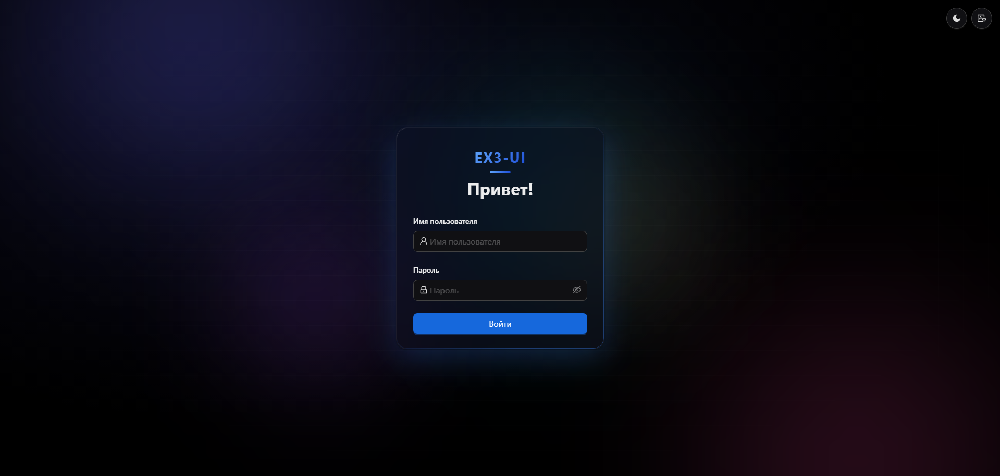
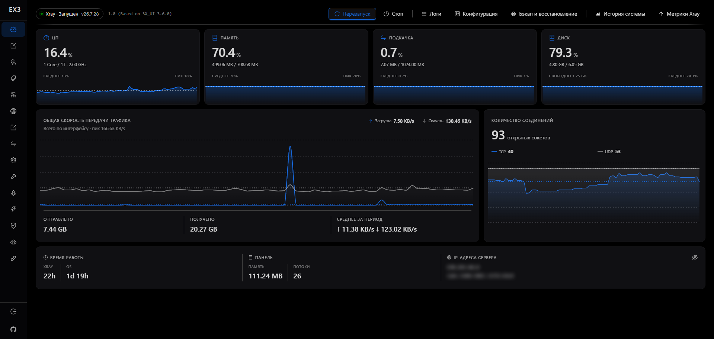
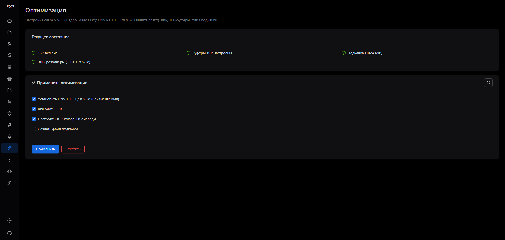
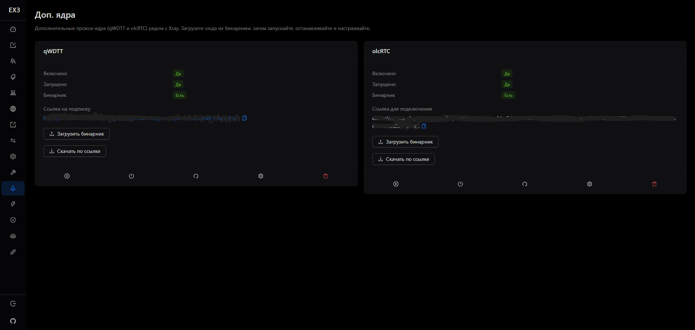
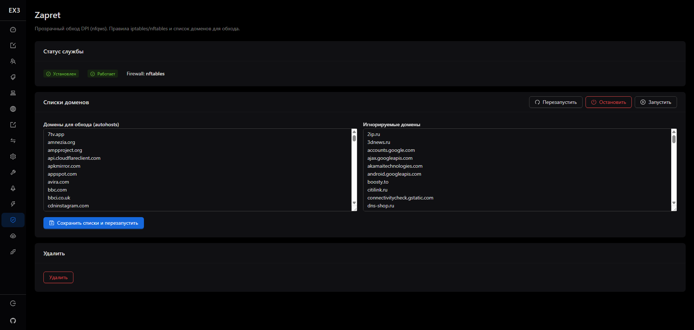
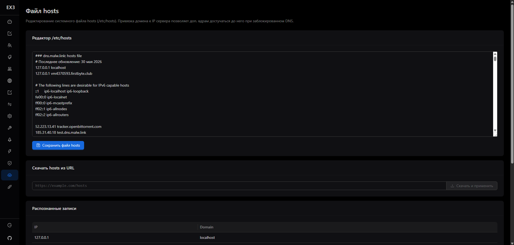

<p align="center">
  
</p>

<p align="center">
  <a href="https://github.com/Bebrik2283555/Ex3-ui/releases"></a>
  <a href="LICENSING.md"></a>
  
</p>

# EX3-UI

**EX3-UI** — форк известной панели [3x-ui](https://github.com/MHSanaei/3x-ui), заточенный под обход блокировок в России и оптимизацию под слабые VPS-серверы.

Текущая версия основана на 3x-ui **3.11.0**.

## Что внутри

- **Поддержка ядер для обхода блокировок через звонки российских сервисов из белого списка:**
  - [qWDTT](https://github.com/SpaceNeuroX/proxy-turn-vk-android) — форк [WDTT](https://github.com/amurcanov/proxy-turn-vk-android)
  - [olcRTC](https://github.com/openlibrecommunity/olcrtc) — TCP-over-WebRTC (Jitsi, Telemost, WbStream).
    Проект переведён автором в EoL, но продолжает работать и остаётся в панели.
  - [CSQTT](https://github.com/amurcanov/csqtt)
- **zapret** — обход DPI-блокировок ([zapret-linux-easy](https://github.com/ImMALWARE/zapret-linux-easy), интегрирован в панель).
  При установке дополнительно прописывает GitHub и Discord в `/etc/hosts` отдельным блоком
  (не пересекается с блоком SmartDNS); при удалении блок убирается.
- **hosts** — обход гео и DPI-блокировок для серверов в России (можно использовать свой список или [этот](https://info.dns.malw.link/hosts))
- **SmartDNS** — резолвинг доменов через выбранный DNS-сервер и запись рабочих адресов в hosts:
  собирает **все** A-записи домена, проверяет каждую реальным TLS-хендшейком с проверкой сертификата
  и отбрасывает адреса, чей edge-регион сервис блокирует (для ChatGPT/OpenAI/Claude), после чего
  выбирает самый быстрый. Если проверка не удалась — остаётся предыдущий рабочий IP (статус `STALE`),
  а не пустая запись. При недоступности основного DNS используются резервные (Cloudflare, Google).
- **Оптимизация под слабые VPS:**
  - установка системного DNS-сервера
  - включение BBR
  - настройка TCP-буферов и очереди
  - создание Swap
## Установка

### С нуля

Введите в терминал (root):

```bash
bash <(curl -Ls https://raw.githubusercontent.com/Bebrik2283555/Ex3-ui/main/install.sh)
```

### На уже установленную панель (без потери данных)

Если у вас уже стоит 3x-ui — это поставит дополнительные ядра и обновит панель, не трогая базу данных и конфиги:

```bash
bash <(curl -Ls https://raw.githubusercontent.com/Bebrik2283555/Ex3-ui/main/install-extra.sh)
```

### Скачивание релизов

| Архитектура | Ссылка |
| --- | --- |
| amd64 | [x-ui-linux-amd64.tar.gz](https://github.com/Bebrik2283555/Ex3-ui/releases/latest/download/x-ui-linux-amd64.tar.gz) |
| arm64 | [x-ui-linux-arm64.tar.gz](https://github.com/Bebrik2283555/Ex3-ui/releases/latest/download/x-ui-linux-arm64.tar.gz) |

## Поддерживаемые архитектуры

`amd64` и `arm64`. Тестировалось на Debian 12 (amd64).

## Скриншоты

<details>
<summary>Скриншоты панели</summary>








</details>

## Примечание

Данный проект написан с помощью ИИ, в некоторых новых функциях могут быть баги.

## Лицензии

<details>
<summary>Показать лицензии компонентов</summary>

| Компонент | Репозиторий | Лицензия |
| --- | --- | --- |
| EX3-UI / 3x-ui панель | [MHSanaei/3x-ui](https://github.com/MHSanaei/3x-ui) | GPL-3.0 |
| xray-core | [XTLS/Xray-core](https://github.com/XTLS/Xray-core) | MPL-2.0 |
| TUIC | [EAimTY/tuic](https://github.com/EAimTY/tuic) | GPL-3.0 |
| mtg-multi (MTProto) | [mhsanaei/mtg-multi](https://github.com/mhsanaei/mtg-multi) | MIT |
| qWDTT (fork WDTT) | [SpaceNeuroX/proxy-turn-vk-android](https://github.com/SpaceNeuroX/proxy-turn-vk-android) | GPL-3.0 |
| WDTT | [amurcanov/proxy-turn-vk-android](https://github.com/amurcanov/proxy-turn-vk-android) | GPL-3.0 |
| olcRTC (EoL upstream) | [openlibrecommunity/olcrtc](https://github.com/openlibrecommunity/olcrtc) | WTFPL-2.0 |
| zapret | [ImMALWARE/zapret-linux-easy](https://github.com/ImMALWARE/zapret-linux-easy) | MIT |
| CSQTT | [amurcanov/csqtt](https://github.com/amurcanov/csqtt) | PolyForm Noncommercial 1.0.0 |

Проект использует смешанную модель: upstream 3x-ui и оригинальный код EX3-UI (включая
менеджер sidecar и интеграцию ядер) — GPL-3.0; CSQTT — отдельный компонент amurcanov
под PolyForm Noncommercial 1.0.0, коммерческое использование требует письменного
разрешения автора. В релизах до 1.5.0 включительно была часть кода из LucX-UI под
PolyForm Noncommercial 1.0.0; в текущем дереве она заменена независимой реализацией
и эти условия больше не применяются.

Полные тексты лицензий — в каталоге [`licenses/`](licenses/)
и в исходниках соответствующих проектов. Полная матрица — в
[`LICENSING.md`](LICENSING.md).

</details>
